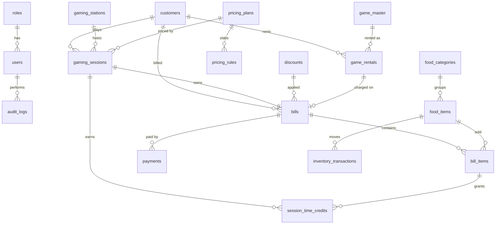

# Console Adda — Architecture & Design

This document covers the specification analysis, architecture, database design,
billing engine and delivery plan for the Console Adda Gaming Cafe Management &
Billing System. It is the reference for every implementation phase.

---

## 1. Specification analysis

### 1.1 Contradictions, ambiguities and the decisions taken

Items marked **⚠ NEEDS OWNER CONFIRMATION** change how much a customer pays.
They are configurable, so a different answer means a configuration change, not a
code change. The defaults below are what the seed data uses until confirmed.

| # | Topic | Problem in the spec | Decision / default |
|---|---|---|---|
| A1 | **Additional-player charge** ⚠ | "Additional player: ₹50 per player tier" does not say whether ₹50 is charged once per session or per hour played. The live-card example (3 players, ₹190 ≈ ₹90 + 2 × ₹50) only shows the 1-hour case. | Charge basis is configurable per pricing plan: `PER_SESSION` or `PER_HOUR` (pro-rated per 30-min block). **Default: `PER_HOUR`** → 2 h for 3 players = ₹150 + 2 × ₹50 × 2 = ₹350. Explicit per-player-count slabs can also be configured and override the surcharge. |
| A2 | **Grace period at later boundaries** ⚠ | "Ignore up to 10 extra minutes" is only illustrated at the 1-hour mark. Is 1 h 38 m billed as 1 h 30 m (grace at every boundary) or 2 h? | **Default: grace applies at every billing boundary** (1 h 40 m → 1 h 30 m; 1 h 41 m → 2 h). Configurable (`grace_minutes`, and a flag to apply grace only at the first boundary). |
| A3 | **15-minute credit trigger** ⚠ | The spec doesn't say which drinks qualify, whether it's automatic, or whether two drinks give 30 minutes. | Each food item has `gaming_credit_minutes` (seed: *Adda Virgin Mojito* = 15). Credit is granted **automatically when a qualifying item is added to a session**, **capped per session** by setting `gaming.credit.max-minutes-per-session` (default 15). The operator can remove it, and every credit is a row in `session_time_credits` with its reason. |
| A4 | Pricing model shape | §7 describes plan rows of *(dayType, playerCount, duration, price)*; §11 describes *base 1-player price + additional-player pricing*. These are two different models. | Both are supported. A **pricing plan** (rate card) holds day type, validity window and rounding rules. **Pricing rules** (slabs) hold *(player_count, duration, price)*. If slabs exist for the exact player count they are used; otherwise the 1-player slabs + the plan's additional-player surcharge apply. |
| A5 | Beyond the largest slab | The ₹45 / 30 min extension isn't specified past 4 hours, and 1 h + extensions can cost more than the next slab (1 h + 2 × ₹45 = ₹180 > 2 h = ₹150). | Price = **cheapest valid combination**: `min over slabs s ≤ D of price(s) + ceil((D − s)/30) × ₹45`, and never more than the next larger slab. So the customer never pays more for playing *less*, and time past 4 h continues at ₹45 per 30 min. |
| A6 | Minimum charge | "12:35 → 12:45 = 1 hour" implies a minimum charge, but this isn't stated as a rule. | `min_billable_minutes` per plan (default 60). Very short sessions started by mistake can be **cancelled** (no charge, audited) instead of completed. |
| A7 | Weekend / special prices | Only weekday prices were given. | Seed data has only a WEEKDAY plan. Plan resolution: an active SPECIAL plan covering the date → else the day-type plan (WEEKEND on Sat/Sun) → else WEEKDAY. So weekend prices equal weekday prices until a WEEKEND plan is added. |
| A8 | Price changes mid-session | Not specified. | The pricing plan is **locked at session start** (`gaming_sessions.pricing_plan_id`). An admin editing prices doesn't change bills for sessions already running. Plans are versioned by validity dates rather than edited in place once used. |
| A9 | GST rates | One "GST percentage" is requested, but in India gaming (services, typically 18%) and restaurant food (typically 5%) usually carry different rates. | Tax is configured **per category** (GAMING, FOOD, RENTAL): enabled flag, rate %, inclusive/exclusive, HSN/SAC code. **Default: GST disabled** for all categories (matches "design so this can be configured later"). Please confirm rates with your CA before enabling. |
| A10 | Customer at session start | §6 says *select customer*; §49's fast path skips it. | Customer is **optional**. Typing a mobile number auto-finds or creates the customer; leaving it blank records a walk-in. Speed wins at the counter. |
| A11 | "Pricing plan" choice at start | The workflow in §49 doesn't include choosing a plan. | The plan is **auto-selected** from date/day type and shown on the start dialog. The operator can override it (e.g. a SPECIAL/event plan). |
| A12 | Bills vs. sessions | The spec puts money fields on the session *and* asks for a `bills` table. Food-only walk-ins and rentals also take money. | The **bill is the single financial document**. A session owns an OPEN bill from the moment it starts (food is added to it during play). Walk-in food sales and rentals create their own bills. Daily closing and reports read bills + payments only, so they can't double-count. |
| A13 | Rental deposits | Is a deposit revenue? | **No.** A deposit is a liability: it's recorded as a `DEPOSIT` payment and a `DEPOSIT_REFUND` on return. It counts in **expected cash** but not in revenue. |
| A14 | Rental pricing unit & late fee | "Rental price" has no period, and the late fee has no rule. | Each game has `rental_price` per `rental_period_days` (default 7) and `late_fee_per_day`. Late days = whole days late (rounded **up**) beyond the expected return time, with a configurable grace of hours (default 2 h). |
| A15 | One title, several discs | ROI is per purchase cost, but the cafe may own two discs of one game. | `game_master` rows are **physical copies** (name + copy number). ROI is reported per copy and aggregated per title. |
| A16 | Business day vs calendar day | A cafe open past midnight would split one night across two dates; daily closing needs a clear cut-off. | Setting `business.day-start-time` (default 06:00, Asia/Kolkata). A bill paid at 01:30 belongs to the previous business date. |
| A17 | Closed day + running session | A session started before closing and ending after it. | Bills belong to the business date when they are **paid**. If that business date is already closed, payment is blocked until an admin reopens it (prevents silent edits to closed books). |
| A18 | Bill number sequence | Reset per year? | Sequence per **(prefix, year)**: `CA-2026-000001`. A number is assigned only when the bill is **paid**, inside the same transaction, from a row-locked counter table, so numbers are gap-free and never duplicated. Cancelled bills keep their number if they had one. |
| A19 | Rounding of the final amount | Not specified. | Lines and taxes are rounded HALF_UP to 2 dp. The grand total is rounded to the **nearest rupee** (HALF_UP) and the difference is stored as `round_off` (configurable, standard Indian retail practice). |
| A20 | Discount allocation with mixed GST rates | One bill-level discount must be split for tax when categories have different rates. | The discount is allocated **pro-rata by category subtotal**; the last category takes the rounding remainder so allocations always sum exactly. |
| A21 | Mid-session player-count changes | Not covered. | Out of scope for v1. The operator edits the player count before ending; the bill uses the final count (audited). Per-segment pricing can be added later without schema breakage. |
| A22 | Refunds | Daily closing lists refunds, but no refund flow is specified. | Admin-only refund on a paid bill: a `REFUND` payment row with a reason, plus an audit entry. The original bill is never edited. |
| A23 | Opening cash | Expected cash needs a starting float. | Daily closing captures **opening cash** (float). Expected cash = opening cash + cash payments + cash deposits − cash refunds − cash deposit refunds. |
| A24 | Operator viewing reports | "View relevant reports" is vague. | Operators see today's live dashboard figures and the daily report for open days. Monthly reports, profit (cost price), ROI and exports are ADMIN-only. |

### 1.2 Minor assumptions (production defaults, no confirmation needed)

* Currency INR, timezone `Asia/Kolkata`. Timestamps are stored in UTC (`DATETIME(6)`) and converted at the edges.
* Mobile numbers: Indian 10-digit (`[6-9]\d{9}`), stored without `+91`, unique per customer.
* Station `code` (e.g. `PS5-01`) is unique and is what operators see. The number of stations comes from the table, never from code.
* `max_players` is a field on the pricing plan (default 4), not a constant.
* Soft delete (deactivate) for master data that has history (stations, food items, games, users, plans). Hard delete only for rows that were never used.
* JWT bearer tokens (HS256) with a 12-hour lifetime (one shift). The token lives in `sessionStorage`. This is a LAN app; an httpOnly-cookie variant can be added if it's ever exposed publicly.
* Single branch. Every business table is reachable from tables that can later receive a `branch_id` column (see §8).

### 1.3 Phase 4 decisions

| Topic | Decision |
|---|---|
| Revenue definition | One definition everywhere (closing, dashboard, reports): only **PAID** bills are sales, dated by their business date. Gaming/food/rental figures are line amounts before discount; **net sales** = bill totals (after discount, with GST and round-off). Payment, refund and deposit totals come from payment rows dated that day. A cancelled bill drops out of its day's sales; its refund appears on the day it was given. |
| Rental money | The rental charge is a RENTAL bill paid when the disc goes out; the **deposit** is a `DEPOSIT` payment on that bill and goes back as `DEPOSIT_REFUND` in the same mode on return (not revenue, but counted in expected cash). A **late fee** is charged on its own RENTAL bill at return, so paid bills are never edited. Deposits are always refunded in full; withholding a deposit for damage is not supported yet. |
| Rental price | Game price covers one period (default 7 days); longer rentals pay per started period. |
| Overdue | Not stored: a rental is shown as `OVERDUE` while it is `OUT` past the expected return time + grace (`rental.late-grace-hours`, default 2 h). Late days = started 24 h periods after the expected return time. |
| Rental cancel | For mistakes only: refunds charge and deposit. Operators within the session cancel window (15 min), admins any time while the disc is out. Rental bills can't be cancelled from the Bills screen. |
| ROI per disc | Revenue = rental charges + late fees of non-cancelled rentals (before GST). ROI = (revenue − cost) ÷ cost; rentals to break even = ⌈cost ÷ current price⌉. |
| Customer count | Distinct customers on paid bills + bills without a customer (each walk-in counts once). |
| Gaming hours | Billed minutes (what the customer paid for). Station utilization uses minutes actually played ÷ (days × `reports.station-hours-per-day`). |
| Profit estimate | Sales excluding GST − food cost at **current** cost prices. Excludes rent, salaries, power and game purchases. Admin only. |
| Closing | Operators close; admins reopen with a reason. A day can't be closed in the future or while sessions are running on it. Starting sessions, walk-in sales, rentals, returns, cancellations and stock entries all check the day is open. |
| Exports | CSV (UTF-8 with BOM for Excel) and real `.xlsx` (Apache POI) from the same report table. Text starting with `= + - @` is prefixed with `'` in CSV to stop spreadsheet formula injection. Ranges are capped at 2 years. |

---

## 2. Architecture

```
 Browser (counter PC / tablet / phone)
   │  HTTPS (reverse proxy in production)
   ▼
 ┌──────────────────────────┐        ┌──────────────────────────────┐
 │ frontend (nginx)          │  /api  │ backend (Spring Boot 3, J21) │
 │ React + TS + Vite + MUI   │ ─────▶ │ controller → service → repo  │
 │ static SPA                │        │ Spring Security (JWT, roles) │
 └──────────────────────────┘        │ Flyway migrations            │
                                      └──────────────┬───────────────┘
                                                     │ JDBC
                                              ┌──────▼──────┐
                                              │  MySQL 8.4  │
                                              └─────────────┘
```

* **One origin for the browser.** nginx serves the SPA and proxies `/api/*` to the backend, so no CORS in production. In development the Vite dev server does the same proxying.
* **Backend layers** (package `com.consoleadda`):
  * `controller`: HTTP only. Validation (`@Valid`), mapping to service calls, status codes. No business logic.
  * `service`: business rules and transactions (`@Transactional`). Pure calculators (billing, rounding, tax) live in `service.billing` with **no Spring or JPA dependencies**, so they can be tested quickly.
  * `repository`: Spring Data JPA, including pessimistic-lock queries for concurrency.
  * `entity`: JPA entities with `@Version` optimistic locking and audit timestamps.
  * `dto` / `mapper`: request/response records. Entities never leave the service layer.
  * `exception`: domain exceptions + `GlobalExceptionHandler` → structured `ApiError`.
  * `config`, `security`: Spring configuration, JWT, role rules.
* **Database:** schema owned by **Flyway** (`ddl-auto=validate` in every profile; Hibernate never creates tables).
* **Money:** `BigDecimal` everywhere, `DECIMAL(12,2)` columns, `RoundingMode.HALF_UP` (see §5.6).

### 2.1 Concurrency strategy

| Risk | Protection |
|---|---|
| Two operators start a session on the same PS5 | (1) `SELECT … FOR UPDATE` on the station row inside the start transaction; (2) **database backstop**: a generated column `active_station_id` (= station_id when status is ACTIVE, else NULL) with a **UNIQUE index**. Even a bug in the service can't create two active sessions. The loser gets `409 STATION_OCCUPIED`. |
| Double-click / two operators completing the same bill | Bill row locked `FOR UPDATE` + status check (`OPEN` only) + `@Version` optimistic locking. Completion requests carry an **idempotency key** (`UNIQUE`), so a retried request returns the original result instead of charging twice. |
| Duplicate bill numbers | Counter row in `bill_number_sequences` locked `FOR UPDATE` in the same transaction that marks the bill PAID + `UNIQUE(bill_number)`. |
| Stock races | Stock changes are insert-only `inventory_transactions`; the cached `food_items.stock_quantity` is updated with an atomic `UPDATE … SET stock = stock + ?` in the same transaction. |
| Editing a closed day | Every action that moves money or stock on a business day first takes a **shared lock** on that day's `daily_closings` row (created as `OPEN` in its own short transaction the first time it's needed); closing takes an **exclusive lock** on it. A closing therefore waits for bills being paid at that moment and includes them, and a bill paid during the closing waits and is then refused (`DAY_CLOSED`). A race test fires sales and the closing together. Admin reopen is audited. |
| Same disc rented twice | Game row locked `FOR UPDATE` + generated `active_game_id` UNIQUE backstop → `409 GAME_ALREADY_RENTED`. |
| Seeing a stale row after waiting for a lock | Session write operations run at **READ COMMITTED**. Under MySQL's default REPEATABLE READ, a request that waited on a row lock could keep reading the snapshot from before the wait (e.g. a retried completion not seeing the bill the first request just committed). |
| Deadlock on the bill-number counter | The counter row is only ever locked with `SELECT … FOR UPDATE`. A new year's row is created in its own committed transaction first. (`INSERT IGNORE` + `FOR UPDATE` in one transaction takes a shared then an exclusive lock and deadlocks when two counters bill at once; found and fixed via the concurrency tests.) |
| Food added while the bill is being completed | Adding/changing/removing food locks the **session row first, then the bill**, the same order as completing; a lock-order race test checks that every unit taken from stock is on the paid bill. |
| Stock going negative when disallowed | `UPDATE food_items SET stock = stock + ? WHERE id = ? AND stock + ? >= 0`: 0 rows → `OUT_OF_STOCK`, no read-then-write race. |
| Customer totals updated by two bills at once | Atomic `UPDATE … SET total = total + ?` instead of read-modify-write on the entity. |
| Same-origin requests behind nginx | nginx forwards `Host` *with port*, Spring uses `ForwardedHeaderFilter`, so the browser's `Origin` matches and CORS doesn't reject the app's own requests. |

---

## 3. Database ERD



### 3.1 Tables

All tables have `id BIGINT PK AUTO_INCREMENT` (except `app_settings`), `created_at`,
and `updated_at` where the row is mutable; mutable aggregates have `version` for optimistic locking.

| Table | Purpose | Key columns / constraints |
|---|---|---|
| `roles` | ADMIN, OPERATOR | `code` UNIQUE |
| `users` | Login accounts | `username` UNIQUE, `password_hash` (BCrypt), `role_id` FK, `active`, `must_change_password`, `failed_login_attempts`, `locked_until`, `last_login_at` |
| `app_settings` | Key/value business settings (cafe name, address, GSTIN, bill prefix, business-day start, credit cap, rounding flags) | `setting_key` PK |
| `tax_settings` | GST per category | `category` UNIQUE (GAMING/FOOD/RENTAL), `enabled`, `rate_percent DECIMAL(5,2)`, `price_mode` (INCLUSIVE/EXCLUSIVE), `hsn_sac_code` |
| `customers` | Customer master + cached totals | `mobile` UNIQUE (nullable), index on `name`; `total_sessions`, `total_gaming_minutes`, `total_spent`, `last_visit_at` |
| `gaming_stations` | Station master | `code` UNIQUE, `name`, `console_label`, `tv_label`, `active`, `display_order`, `notes` |
| `pricing_plans` | Rate cards | `name` UNIQUE, `day_type`, `active_from`, `active_to`, `active`, `priority`, `min_billable_minutes`, `billing_block_minutes`, `grace_minutes`, `grace_every_boundary`, `extension_block_minutes`, `extension_price`, `additional_player_price`, `additional_player_basis`, `max_players` |
| `pricing_rules` | Duration slabs | FK plan; `player_count`, `duration_minutes`, `price`; UNIQUE(plan, player_count, duration) |
| `discounts` | Configurable discounts | `code` UNIQUE, `discount_type` (PERCENTAGE/FLAT), `value`, `max_amount`, `valid_from/to`, `active`; CHECK value ≥ 0 |
| `food_categories` | Menu categories | `name` UNIQUE, `display_order` |
| `food_items` | Menu + stock | `name` UNIQUE, FK category, `selling_price`, `cost_price`, `stock_quantity` (cache), `reorder_level`, `track_inventory`, `gaming_credit_minutes`, `active`; CHECK prices ≥ 0 |
| `inventory_transactions` | Stock ledger (insert-only) | FK item, `txn_type` (OPENING/PURCHASE/SALE/SALE_REVERSAL/WASTAGE/ADJUSTMENT), signed `quantity`, `unit_cost`, `reference_type/id`, `business_date`, `created_by`; index (item, business_date) |
| `bills` | Financial document | `bill_number` UNIQUE (NULL until paid), `bill_type` (GAMING/WALK_IN/RENTAL), `status` (OPEN/PAID/CANCELLED), customer FK + name/mobile snapshot, `gaming_amount`, `food_amount`, `rental_amount`, `subtotal`, discount FK + `discount_amount`, `taxable_amount`, `tax_amount`, `round_off`, `total_amount`, `business_date`, `idempotency_key` UNIQUE, `paid_at`, `cancel_reason` |
| `bill_items` | Lines | FK bill, `item_type` (GAMING/FOOD/RENTAL/LATE_FEE/OTHER), FK food item (nullable), `description`, `quantity`, `unit_price` (snapshot), `line_total`, `tax_category` |
| `bill_number_sequences` | Gap-free numbering | UNIQUE(prefix, year), `next_value` |
| `payments` | Money in/out | FK bill, `payment_type` (PAYMENT/REFUND/DEPOSIT/DEPOSIT_REFUND), `mode` (CASH/UPI/CARD/OTHER), `amount` > 0, `reference_no`, `business_date`; index (business_date, mode). Split payments = multiple rows. |
| `gaming_sessions` | Play sessions | FK station, customer, bill (UNIQUE), pricing_plan; `player_count`, `started_at`, `ended_at`, `actual_minutes`, `credit_minutes`, `billable_minutes`, `gaming_amount`, `status`; generated `active_station_id` **UNIQUE** |
| `session_time_credits` | 15-min credits (with reason) | FK session, FK bill_item (source), `minutes`, `reason`, `created_by` |
| `game_master` | Physical game copies | UNIQUE(name, copy_number), `purchase_price`, `rental_price`, `rental_period_days`, `late_fee_per_day`, `default_deposit`, `available_for_rental`, `active` |
| `game_rentals` | Rental transactions | `rental_number` UNIQUE, FK game, customer, bill; `out_at`, `expected_return_at`, `returned_at`, `late_fee_bill_id`, `rental_price`, `deposit_amount`, `late_days`, `late_fee`, `deposit_refunded`, `status`; generated `active_game_id` **UNIQUE** |
| `daily_closings` | End-of-day snapshot (one row per business day, also the day lock) | `business_date` UNIQUE, `status` (OPEN/CLOSED/REOPENED), `bill_count`, `round_off_total`, `deposit_total`, `deposit_refund_total`, all revenue/payment-mode totals, counts, `opening_cash`, `expected_cash`, `actual_cash`, `cash_difference`, `closed_by`, `reopened_by`, `reopen_reason` |
| `audit_logs` | Who did what | `user_id`, `username` snapshot, `action`, `entity_type`, `entity_id`, `old_value` JSON, `new_value` JSON, `ip_address`, `created_at`; indexes on (entity_type, entity_id) and created_at |

The complete DDL is in `backend/src/main/resources/db/migration/V1__baseline_schema.sql`.

---

## 4. Project structure

```
.
├── docker-compose.yml          # mysql + backend + frontend
├── .env.example                # all secrets/config via env vars
├── README.md
├── docs/ARCHITECTURE.md        # this document
├── backend/
│   ├── Dockerfile              # multi-stage Maven build → JRE 21 runtime
│   ├── pom.xml
│   └── src/
│       ├── main/java/com/consoleadda/
│       │   ├── config/  security/  controller/  service/  service/billing/
│       │   ├── repository/  entity/  dto/  mapper/  exception/
│       │   └── ConsoleAddaApplication.java
│       ├── main/resources/
│       │   ├── application.yml, application-dev.yml, application-prod.yml
│       │   ├── logback-spring.xml
│       │   └── db/migration/   # Flyway V1 schema, V2 seed data, …
│       └── test/java/…         # unit tests + Testcontainers (MySQL) integration tests
├── frontend/
│   ├── Dockerfile              # node build → nginx
│   ├── nginx.conf              # SPA + /api reverse proxy
│   └── src/
│       ├── api/                # axios client, typed API modules
│       ├── auth/               # auth context, guards
│       ├── components/         # shared UI (layout, cards, dialogs)
│       ├── pages/              # one folder per module
│       └── theme.ts            # dark gaming theme
└── the-console-adda/           # pre-existing Next.js scaffold (unused, see README)
```

---

## 5. Billing calculation engine

The engine is a set of **pure functions** (no DB, no clock) in `service.billing`.
The session service loads the plan, credits and bill lines and passes them in, so
every rule is unit-testable with plain inputs.

### 5.1 Inputs
`startedAt`, `endedAt`, `playerCount`, `PricingPlan` (+ its rules), credit minutes,
food lines, discount, tax settings, rounding settings.

### 5.2 Step 1: durations
```
actualMinutes   = floor((endedAt − startedAt) in seconds / 60)       // partial minutes are not charged
netMinutes      = max(0, actualMinutes − creditMinutes)               // 15-min credit, recorded separately
billableMinutes = roundBillable(netMinutes, plan)
```

### 5.3 Step 2: billable time rounding
With `min = 60`, `block = 30`, `grace = 10` (all configurable per plan):
```
if net ≤ min + grace                → billable = min
else billable = smallest  min + k·block  (k ≥ 1)  such that  net ≤ billable + grace
```
(If `grace_every_boundary = false`, grace is only applied at the first boundary.)

| Actual | Billable | Why |
|---|---|---|
| 0:10 (12:35→12:45) | 1:00 | minimum charge |
| 1:00 / 1:05 / 1:10 | 1:00 | within grace |
| 1:11 | 1:30 | next block |
| 1:30 / 1:40 | 1:30 | within grace of 1:30 |
| 1:41 | 2:00 | |
| 2:15 | 2:30 | |
| 1:15 with 15-min credit | 1:00 | net 1:00 |

### 5.4 Step 3: gaming price
```
base(D) = min( min over slabs s ≤ D : price(s) + ceil((D − s) / extBlock) × extPrice ,
               min over slabs s ≥ D : price(s) )
```
using the slabs for the exact player count if they exist, else the 1-player slabs, then
```
surcharge = additionalPlayerPrice × (players − 1) × (basis == PER_HOUR ? D / 60 : 1)
gaming    = base(D) + surcharge
```

With the seed data (1 h ₹90, 2 h ₹150, 3 h ₹240, 4 h ₹330, +30 min ₹45, +₹50/player/hour):

| Billable | 1 player | 3 players (PER_HOUR) |
|---|---|---|
| 1:00 | ₹90 | ₹190 |
| 1:30 | ₹135 | ₹285 |
| 2:00 | ₹150 | ₹350 |
| 2:30 | ₹195 | ₹445 |
| 4:30 | ₹375 | ₹825 |

### 5.5 Step 4: bill totals
```
subtotal        = gaming + Σ food lines + rental lines           (each line = qty × unit price, 2 dp)
discount        = PERCENTAGE: subtotal × pct / 100 (capped by max_amount) | FLAT: min(value, subtotal)
allocate discount pro-rata to categories (GAMING/FOOD/RENTAL), remainder to the last
per category:   taxable_c = subtotal_c − discount_c
                EXCLUSIVE: tax_c = taxable_c × rate / 100
                INCLUSIVE: tax_c = taxable_c × rate / (100 + rate)      (already inside the price)
total           = Σ taxable_c + Σ tax_c(EXCLUSIVE only)
grandTotal      = round(total, 0, HALF_UP)  ;  roundOff = grandTotal − total
```
Original item prices are never changed. The discount is its own field and audit event.

### 5.6 Rounding strategy (documented)
* All amounts are `BigDecimal`. No `float`/`double` anywhere in money paths.
* Every intermediate monetary result is rounded to **2 decimals, HALF_UP** as soon as it's produced (line totals, surcharges, each category discount allocation, each tax amount).
* Percentages keep 4 dp internally until applied.
* Grand total → nearest rupee HALF_UP, with `round_off` stored (setting `billing.round-to-rupee`, default true).
* Time is billed in whole minutes (seconds truncated): the customer is never charged for a partial minute.
* The application clock ticks in **microseconds**, matching MySQL `DATETIME(6)`. MySQL *rounds* extra
  precision, so a nanosecond start time could be stored slightly later than the value used in code, and
  exactly 71 minutes could become 70.99999 and be billed one interval too low. Found by the integration tests.
* GST is stored per bill and category in `bill_tax_lines` (rate, mode, SAC/HSN, taxable value, tax) at
  payment time. Invoices read these rows, so changing GST settings never alters an issued bill. CGST/SGST
  are shown as halves of the stored tax (intra-state supply).
* Free gaming credit is recomputed from the bill's lines after every food change (minutes × quantity,
  capped per session) and stored in `session_time_credits` with the source line and reason.
* The END preview freezes the end time. Completing the bill uses that time (accepted up to
  `session.max-end-backdate-minutes` old, never in the future), so the customer pays for what they reviewed
  even if payment takes a minute.

---

## 6. API structure

REST, JSON, `/api` prefix. Errors are always:
```json
{ "timestamp": "...", "status": 409, "error": "Conflict", "code": "STATION_OCCUPIED",
  "message": "PS5-02 already has an active session", "path": "/api/sessions",
  "validationErrors": [ { "field": "playerCount", "message": "must be between 1 and 4" } ] }
```

| Area | Endpoints | Role |
|---|---|---|
| Auth | `POST /api/auth/login`, `GET /api/auth/me`, `POST /api/auth/change-password` | public / any |
| Stations | `GET /api/stations` · `POST`, `PUT /{id}`, `PATCH /{id}/status`, `DELETE /{id}` | any · ADMIN |
| Sessions | `POST /api/sessions`, `GET /api/sessions/active`, `GET /api/sessions/{id}`, `GET /api/sessions/{id}/estimate`, `PATCH /api/sessions/{id}` (players), `POST /api/sessions/{id}/items`, `DELETE /api/sessions/{id}/items/{itemId}`, `POST /api/sessions/{id}/end` (preview), `POST /api/sessions/{id}/complete`, `POST /api/sessions/{id}/cancel` | OPERATOR+ |
| Pricing | `GET /api/pricing` · `POST`, `PUT /{id}`, `GET /api/pricing/quote` | any · ADMIN |
| Bills | `POST /api/bills` (walk-in), `GET /api/bills?query`, `GET /api/bills/{id}`, `GET /api/bills/{id}/invoice`, `POST /api/bills/{id}/cancel`, `POST /api/bills/{id}/refunds` | OPERATOR+ / ADMIN for cancel-after-pay & refund |
| Food & inventory | `GET/POST/PUT /api/food-items`, `GET/POST /api/food-categories`, `GET/POST /api/inventory/transactions`, `GET /api/inventory/stock` | read any · write ADMIN (sales are automatic) |
| Customers | `GET /api/customers?search=`, `POST`, `PUT /{id}`, `GET /{id}/history` | OPERATOR+ |
| Games & rentals | `GET/POST/PUT /api/games`, `GET /api/games/{id}/roi`, `POST /api/rentals`, `GET /api/rentals`, `POST /api/rentals/{id}/return`, `POST /api/rentals/{id}/cancel` | OPERATOR+ (games master ADMIN) |
| Daily closing | `GET /api/daily-closing/{date}/preview`, `POST /api/daily-closing`, `POST /api/daily-closing/{date}/reopen` | OPERATOR+ · reopen ADMIN |
| Dashboard & reports | `GET /api/dashboard`, `GET /api/reports/{daily,monthly,gaming,food,payments,stations,customers,rentals,inventory}` + `?format=csv` | per §1.1 A24 |
| Settings | `GET/PUT /api/settings`, `GET/PUT /api/settings/tax`, `GET/POST/PUT /api/discounts`, `GET/POST/PUT /api/users` | ADMIN |
| Audit | `GET /api/audit-logs` | ADMIN |

Interactive docs: Swagger UI at `/swagger-ui.html` (OpenAPI at `/v3/api-docs`).

---

## 7. Implementation phases

| Phase | Scope | Exit criteria |
|---|---|---|
| **1** | Architecture, full schema (Flyway V1) + seed data (V2), Spring Boot skeleton, error handling, logging, JWT auth + roles + forced password change, read-only station list, Docker/compose, React shell (login, layout, navigation, Live Sessions station grid) | Backend compiles, tests pass against real MySQL (Testcontainers), `docker compose up` serves login → station grid |
| **2** | Station admin CRUD, pricing master, rounding + pricing engine, session start/estimate/end/complete/cancel, concurrency tests | Billing test matrix green; duplicate-station test proves the DB backstop |
| **3** | Food master, add food to session, walk-in bills, discounts, GST, payments, bill numbering, inventory ledger, invoice (A4 + 80 mm thermal) | Food/discount/GST/inventory tests green |
| **4** | Customers + history, game master, rentals + late fees + ROI, dashboard + charts, reports + CSV/Excel export, daily closing | Rental and closing tests green |
| **5** | Admin panel completeness (settings, users, discounts, tax), audit log everywhere, login lockout, security hardening | Security test matrix green |
| **6** | Full regression, bug fixing, UI polish, Docker verification, production-readiness review | Clean `docker compose up` from scratch; README verified |

---

## 8. Future extensibility (not implemented)

| Feature | How the design leaves room |
|---|---|
| Passes / memberships / loyalty / coupons | New tables referencing `customers`; coupons extend `discounts`; the billing pipeline takes a list of adjustments rather than a single discount field. |
| Tournaments, online booking | Bookings would reserve `gaming_stations` by time; the active-session unique index is unaffected. |
| WhatsApp / notifications | Business events are published from services (`ApplicationEventPublisher`) and can be consumed by a notifier later. |
| Multiple branches | Add `branches` + `branch_id` on stations, bills, sessions, rentals, closings, settings; unique keys become (branch_id, …). Bill prefix is already a setting. |
| Online payments / QR ordering | `payments.mode` + `reference_no` hold gateway references; split payments already modelled. |
| Cloud deployment | Stateless backend (JWT), all config via env vars, Flyway-managed schema, containerised. |
